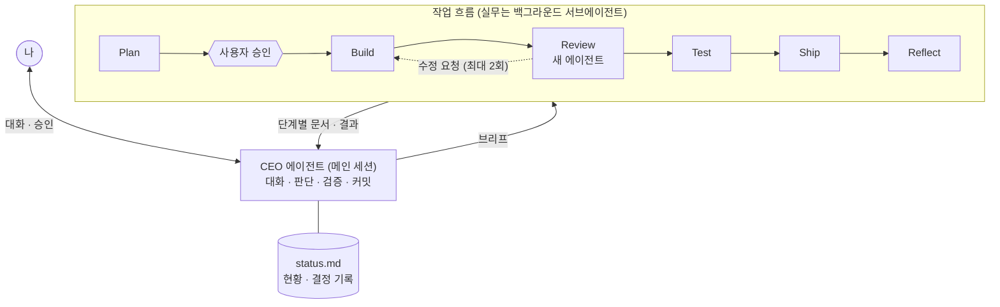

이제는 정말 AI 없이 개발하기 어려운 시대가 되었다. 처음에는 AI 도입을 망설이던 시니어 개발자분들도 이제는 AI가 좋다고 하시는 걸 보면, 짧은 시간 동안 참 많은 것이 바뀌었다.

그런데 많은 사람이 AI를 쓰게 된 것과 별개로, AI를 "잘" 쓰는 것이 무엇인지에 대해서는 여전히 의견이 분분하다. 나 역시 지금 AI를 잘 쓰고 있느냐고 묻는다면 "글쎄"라고 답할 것 같다.

그래도 지금 내가 생각하는 기준은 두 가지 정도로 정리할 수 있다. 하나는 하네스를 기반으로 에이전트들을 엮어 하나의 워크플로우를 만들고, 일하는 방식에 일관성을 갖는 것이다. 다른 하나는 토큰 관리다. 쓰고 있는 요금제 안에서, 일하는 시간 동안 토큰이 바닥나지 않게 하는 것도 중요하다.

이 두 가지를 나란히 놓고 보면 AI를 잘 쓴다는 건 어떻게 보면 회사의 대표가 되는 일과 꽤 닮아 있다. 대표는 회사가 늘 같은 방식으로 일하도록 체계를 만들고, 정해진 예산 안에서 자원을 나눠 쓴다. AI와 일할 때는 요금제가 예산이고, 토큰이 자원인 셈이다.

이번 글에서는 내가 AI를 쓰는 방식이 어떻게 바뀌어 왔는지 회고해 보려 한다. 먼저 AI를 챗봇처럼 쓰던 시절부터 스킬을 만들기까지를 돌아보고, 플러그인 프로토타입을 만들며 깨달은 것들, 그리고 그 끝에 나온 두 개의 플러그인 이야기를 차례로 해 보려고 한다.

# 묻는 AI에서 맡기는 AI로

처음에는 AI를 그냥 챗봇처럼 썼다. 코드나 에러 로그를 붙여 넣고 디버깅이나 수정 코드를 받아 오는, 지금 생각하면 아주 원시적인 방식이었다. 당시에는 유료 요금제도 쓰지 않았고, GPT가 최고이던 시절이었다.

그러다 Claude Code의 스킬, 훅, 룰 같은 기본 요소를 하나씩 익혀 가면서, AI에게 질문을 던지는 게 아니라 AI와 같이 일하고 있다는 느낌이 조금씩 들기 시작했다.

당시 맡았던 프로젝트에서 처음 만든 스킬은 규격을 다루는 스킬이었다. 여기에는 두 가지 장치를 넣었다.

하나는 버전이다. 규격 문서마다 버전을 명시해 두고, 스킬이 늘 최신 버전의 문서만 참고하게 했다. 덕분에 규격이 바뀌어도 AI는 항상 최신 규격대로 작업했다.

다른 하나는 마크다운 변환이다. 규격 원본은 대부분 엑셀이나 PDF였는데, AI가 이걸 매번 그대로 읽게 하는 대신 처음 참조할 때 마크다운으로 변환해 두었다. 그다음부터는 변환된 문서에서 필요한 부분만 찾아 읽으니, 훨씬 빠르고 정확하게 원하는 내용을 찾을 수 있었다.

두 번째는 JIRA 스킬이었다. 회사에서는 이슈를 JIRA로 관리하는데, JIRA 이슈를 가져와 분석하고 수정 · 커밋까지 자동으로 진행하는 스킬을 만들었다. 나에게는 수정 내용과 커밋 여부만 묻는다.

규격이 빠르게 바뀌고 그에 따라 이슈도 많이 올라오던 프로젝트라, 이 두 스킬이 굉장히 큰 도움이 됐다. 다만 돌아보면 이때는 AI에게 일을 하나씩 가르치던 단계였다. 일을 맡길 수는 있었지만, 아직 체계라고 부를 만한 것은 없었다.

# 한 장의 매뉴얼에서 하나의 회사로

AI에 꽤 익숙해졌다고 느낄 즈음, 플러그인을 만들어 보고 싶어졌다.

Claude Code 문서의 정의를 빌리면, 플러그인은 스킬, 에이전트, 훅, MCP 서버 같은 구성 요소를 담아 하나의 단위로 설치하고 불러오는 디렉터리다. 지금까지 스킬로 업무 매뉴얼을 한 장씩 써 왔다면, 플러그인은 회사를 하나 만들어 보는 것이다.

앞에서 AI를 잘 쓰는 기준으로 일관성을 꼽았는데, 그걸 처음 진지하게 원하게 된 시점이 바로 이때였던 것 같다. 프로젝트마다, 그날그날 중구난방으로 AI를 쓰는 게 아니라, 내가 일하는 방식을 한 번 정의해 두고 어디서나 같은 방식으로 일하고 싶었다.

그렇게 여러 개의 프로토타입을 만들어 테스트하면서 몇 가지를 깨달았다.

## 대표가 실무를 붙잡으면 결재가 멈춘다

처음에는 내가 CEO 역할을 하면 된다고 생각했다. 그런데 해 보니 CEO 에이전트는 반드시 필요했다.

핵심은 하나의 세션에서 여러 일을 관리하는 것이다. CEO 에이전트를 두고 하위 에이전트에 작업을 나누지 않으면, 세션이 긴 작업 하나에 묶여 버린다. 그러면 나는 중간에 끼어들 수 없고, 그 세션이 통째로 병목이 된다. 대표가 직접 실무를 붙잡고 있는 바람에 결재가 전부 멈춰 버리는 것과 비슷하다.

내가 원한 건 대화는 끊기지 않고 계속 이어지면서, 실제 작업은 하위 에이전트들이 뒤에서 차곡차곡 처리하는 형태였다. 서브에이전트를 백그라운드로 돌리면 메인 세션은 그동안에도 계속 대화를 받을 수 있다. 게다가 서브에이전트는 메인 대화와 분리된 자기 컨텍스트에서 일하고 결과만 돌려주기 때문에, 탐색하느라 읽은 파일들이 메인 세션의 컨텍스트를 채우지 않는다는 장점도 있다.

## 결국 돌아오는 곳은 텍스트였다

여러 작업을 동시에 진행하다 보니, 이걸 한눈에 보고 싶어졌다. 그래서 대화가 진행되는 상황을 화면에 실시간으로 반영해 세션을 시각화하려고 했다. 요즘 [Pixel Agents](https://github.com/pablodelucca/pixel-agents)처럼 에이전트를 도트 캐릭터로 띄워 게더타운 같은 가상 사무실에서 일하는 모습을 보여 주는 도구들이 많이 나오는데, 비슷한 걸 생각했던 것이다.

그런데 막상 일을 하다 보면, 결국 대화창이나 터미널로 돌아와 있는 나를 발견하게 됐다. 캐릭터가 움직이는 화면은 보는 재미는 있었지만, 실제로 일을 판단하고 지시하는 곳은 늘 텍스트였다. AI와 일할 때 시각화는 생각만큼 큰 의미가 없었다.

무엇보다 결정적이었던 건, 내가 실제로 통제할 수 있는 작업이 수십 개가 아니라는 사실이었다. 몇십 가지 일을 동시에 시킬 수는 있다. 하지만 결국 내가 따라가지 못하는 지점, 즉 사람이 병목이 되는 지점이 반드시 생긴다.

그래서 시각화는 빼고, 내가 인지할 수 있는 범위 안에서 작업을 최대한 늘리는 쪽을 택했다. 그 정도라면 텍스트만으로도 충분히 파악할 수 있었다.

## 일하는 방식은 달라도 지식은 맞출 수 있다

프로토타입을 이것저것 만들던 중, 팀에서 Claude Code를 팀 플랜으로 쓴다는 이야기를 들었다. 그래서 팀 차원에서 워크플로우를 통일해 볼까 하는 생각이 들었다.

그런데 막상 확인해 보니 다들 쓰는 방식이 제각각이었다. 각자 이미 자기 방식에 익숙해져 있는 상황에서 워크플로우를 하나로 맞추는 건 큰 의미가 없어 보였다.

그때 문득 떠오른 것이 "지식 체계를 통일하면 어떨까"였다. 일하는 스타일은 사람마다 달라도, 지식을 쌓아 두는 방식은 맞출 수 있다. 그래서 플러그인을 둘로 나눴다. 일하는 방식을 담은 업무용 플러그인은 나만 쓰고, 지식을 담는 지식 플러그인은 팀과 함께 쓰기로 했다.

# 어디서든 같은 방식으로 일한다

먼저 내 업무용 플러그인이다. 작업 방식을 프로젝트에서 완전히 떼어 하나의 플러그인으로 만들었고, user 스코프로 설치해 두어서 어느 저장소를 열어도 항상 같은 방식으로 일할 수 있게 되었다.

내가 생각한 설계를 이미 잘 구현해 둔 스킬과 플러그인이 많아서, 바닥부터 만들지는 않았다. 스킬은 [superpowers](https://github.com/obra/superpowers)(MIT)에서 가져와 고쳤고, 운영 방식은 [gstack](https://github.com/garrytan/gstack)을 분석해서 필요한 부분만 다시 설계했다.

## 메인 세션은 판단하고, 실무는 맡긴다

메인 세션은 대화와 판단, 검증, 커밋만 하고, 실무는 백그라운드 서브에이전트에게 맡긴다. 일은 일곱 단계로 흐르고, 단계마다 남긴 문서를 다음 에이전트가 이어받는다.

Review는 구현하지 않은 새 에이전트가 맡는다. 자기가 만든 결과를 스스로 검토하면 오류를 놓치기 쉽기 때문이다. 두 번 고쳐도 같은 문제가 남으면 멈추고 나에게 묻는다. 에이전트는 커밋 · 푸시 · JIRA 쓰기를 할 수 없고, CEO가 diff와 빌드 결과를 직접 확인한 뒤에야 완료를 보고한다. 현황과 내가 내린 결정은 status.md에 적어 두어서, 세션이 끊겨도 이어 갈 수 있다.

## 토큰이 바닥나기 전에 세션을 바꾼다

서론에서 꼽은 또 하나의 기준인 토큰 관리도 이 플러그인에 담았다. 한 세션에서 오래 일할수록 컨텍스트가 쌓이고, 도구를 한 번 부를 때마다 그 컨텍스트를 통째로 다시 읽으니 토큰도 그만큼 빨리 줄어든다.

그래서 hand-off 스킬을 만들었다. 컨텍스트가 일정 크기를 넘으면 세션을 바꾸라는 메시지를 보내고, 커맨드를 실행하면 지금까지의 진행 상황을 메모로 남긴다. 새 세션은 그 메모를 읽고 이어서 일하면 된다. 앞에서 실무를 서브에이전트에게 맡긴 것도 같은 맥락이다. 탐색하며 읽은 파일이 메인 세션에 쌓이지 않으니, 세션 하나를 더 오래 쓸 수 있다.

예산이 바닥난 뒤에 허둥대기보다, 바닥나기 전에 정리하고 넘기는 쪽이 결국 하루를 끝까지 일하게 해 준다.

# 지식은 같은 형태로 쌓는다

다음은 팀과 함께 사용하는 지식 플러그인이다. 업무용 플러그인이 "어떻게 일하는가"를 담는다면, 지식 플러그인은 "무엇을 아는가"를 담는다.

## 지식은 결국 프로젝트의 지식이다

지식 플러그인은 처음부터 지금 모양이 아니었다. 처음에는 지식을 플러그인 안에 넣었고, 그 다음에는 지식 저장소를 따로 두고 MCP 서버로 읽게 했고, 마지막으로 지식을 각 프로젝트 저장소 안으로 옮겼다. 세 가지 구조를 거친 셈이다.

첫 번째와 두 번째 구조는 모두 공통 지식을 관리하고 싶어서 만들었다. 안드로이드 팀의 공통 규칙 같은 것을 한곳에서 관리하려고 중앙에 두었던 것이다. 플러그인만 설치하면 누구나 같은 기준으로 바로 일하게 만들고 싶었던 것 같다.

그런데 해 볼수록 "굳이?"라는 생각이 들었다. 지식은 결국 프로젝트의 지식이다. 프로젝트 저장소에 바로 커밋하는 편이 훨씬 빠르고, 지식이 코드 옆에 있으니 따로 띄울 서버도, 맞춰 둘 훅도 필요 없다. 게다가 지식이 코드와 같은 브랜치, 같은 리뷰를 따라가니, 코드가 바뀔 때 지식도 같이 바뀌는지 자연스럽게 확인할 수 있었다.

## 내용은 달라도 형태는 같게

그다음에는 지식의 내용은 프로젝트마다 조금씩 다르더라도, 같은 형태로 쌓이면 좋겠다는 생각이 들었다. 그래서 지식 플러그인은 프로젝트 지식을 하나의 형태로 쌓는 데 집중한다.

API 문서, UI 규격서, 버그에서 얻은 교훈, 작업 규칙, 코드 틀, 릴리즈 절차가 각 프로젝트 저장소의 knowledge/ 폴더에 정해진 규격으로 들어간다. 지식 플러그인을 쓴다면, 어느 프로젝트에 가도 지식이 같은 형태로 놓여 있으니, 처음 보는 프로젝트라도 어디서 무엇을 찾아야 할지 바로 알 수 있다.

이 형태를 지키기 위해 세 가지 장치를 넣었다.

첫 번째는 지식이 들어오는 입구인 domain-add 스킬이다. "이 문서 정리해줘" 한마디면 받은 문서를 성격별로 나눈다. 잘 안 바뀌는 원본은 요약하지 않고 숫자와 조건을 그대로 옮기고, 자주 바뀌는 것은 위치만 링크로 남긴다. 요약하는 순간 숫자 하나가 틀어질 수 있고, 자주 바뀌는 걸 옮겨 두면 금세 낡기 때문이다. 교훈은 한 줄로, 원인을 찾아간 과정은 사례로 따로 둔다. 그리고 무엇을 더할지 먼저 제안한 뒤, 내가 승인한 것만 쓴다.

두 번째는 규격 검사기다. 저장하기 전에 문서를 검사해서, 옮긴 문서에 출처 · 버전 · 옮긴 날짜가 있는지, 교훈마다 근거(커밋 · 이슈 키 · 사례 · 출처)가 붙어 있는지, 길이 상한과 YAML 형식은 맞는지를 보고 고칠 곳을 알려 준다. 지식을 모으다 보면 근거 없는 추측이 슬쩍 섞이거나 지식이 금세 낡는데, 이걸 사람의 꼼꼼함에 맡기지 않고 검사기로 막아 두려는 것이다.

세 번째는 지식을 사람이 읽기 좋게 보여 주는 knowledge-view 스킬이다. 쌓인 지식을 [Zensical](https://zensical.org)로 정적 사이트로 만들어 브라우저로 연다.

# 강제하기보다 받쳐 줄 때

팀에서 가장 반응이 좋았던 건 지식을 정적 사이트로 볼 수 있다는 점이었다. 가독성이 좋고 편하다는 이야기를 들었고, 도입이 어렵지 않아서 좋다는 이야기도 들었다.

확실히 작업 방식을 강제하는 플러그인보다, 하던 일을 옆에서 받쳐 주는 플러그인이 팀에는 더 잘 맞는다는 생각이 들었다. 업무용 플러그인을 팀에 나눠 주지 않기로 한 게 맞는 선택이었던 셈이다.

# 마치며

이번 글은 꽤나 달려온 2026년을 돌아보며 쓰게 되었다. 회고라고 하기에는 AI 이야기만 있긴 하지만, 올해는 해커톤 세 개에 참여해 NHN의 게임 × AI 해커톤인 [NAN 2026](https://www.xportsnews.com/article/2193326)에서 우수상도 받아 보고, 회사에서도 AI와 관련해 인정받을 기회를 여럿 마주했다. 그러면서 "아, 조금은 성장했나?" 하는 생각이 들었고, 그동안 내가 AI를 어떻게 써 왔는지 더듬어 보며 이 글을 쓰게 되었다.

여전히 이곳저곳에서 화려하고 멋진 AI 활용 글들을 보면 FOMO를 매번 느낄 만큼 부족한 점이 많다. 그래도 내가 일하는 방식에 일관성이 생겼다는 점은 뿌듯하다. 어쩌면 개발자로 보낸 5년이 헛되지는 않았구나 하는 생각도 든다.

이제 AI와 나의 일을 따로 떼어 생각하기는 어려워졌다. 그런 만큼 AI를 가까운 동료로 두고, 때로는 그 동료들을 이끄는 대표로서, 함께 잘 일하는 방법을 계속 찾아가야겠다.